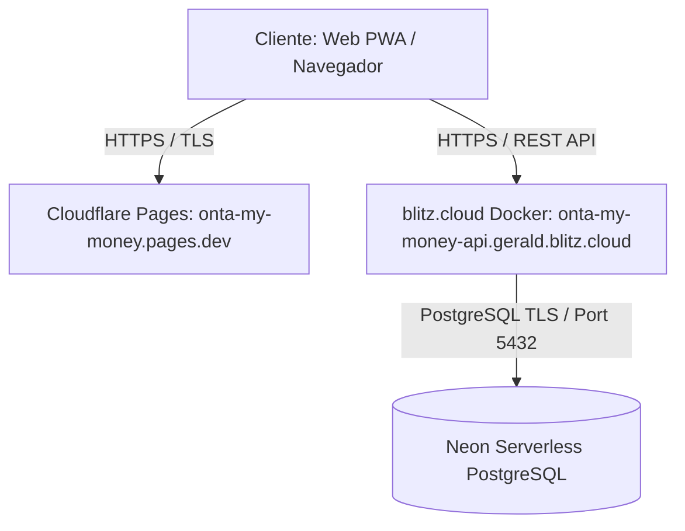

# Guía de Despliegue en Producción — ONTA MY MONEY

Esta guía detalla la infraestructura, configuración y procedimientos operativos para el despliegue de **ONTA MY MONEY** en producción.

---

## 1. Arquitectura General y Servicios



- **Frontend**: Flutter Web (PWA con persistencia Drift SQLite / Wasm) alojado en **Cloudflare Pages**.
  - Dominio: `https://onta-my-money.pages.dev`
- **Backend**: API REST compilada en Dart con runtime nativo Debian, empaquetada en contenedor Docker y alojada en **blitz.cloud**.
  - Dominio: `https://onta-my-money-api.gerald.blitz.cloud`
  - Servicio: `onta-my-money-api`
- **Base de Datos**: **Neon Serverless PostgreSQL** con cifrado TLS obligatorio en tránsito.

---

## 2. Repositorios Definitivos en GitHub

Los repositorios oficiales bajo la cuenta `Gerald120904` son:

- **Frontend**: `https://github.com/Gerald120904/Onta-my-money.git`
  - Ramas activas: `main` (despliegue continuo Cloudflare) y `feature/offline-first`.
- **Backend**: `https://github.com/Gerald120904/Onta-my-backend.git`
  - Ramas activas: `main` y `feature/offline-first` (rama conectada al servicio blitz.cloud).

---

## 3. Variables de Entorno del Backend

En el panel de configuración del servicio `onta-my-money-api` en **blitz.cloud**, las siguientes variables deben estar configuradas:

| Variable | Valor de Producción | Descripción |
|---|---|---|
| `PORT` | `8080` | Puerto TCP en el que el servidor escucha peticiones HTTP. |
| `ENVIRONMENT` | `production` | Activa las protecciones estrictas de producción: TLS obligatorio, prohibición de SQLite como fallback y validación de orígenes CORS. |
| `DATABASE_URL` | `postgresql://[USER]:[PASSWORD]@[ENDPOINT].neon.tech/neondb?sslmode=require` | Cadena de conexión segura a Neon PostgreSQL. Debe incluir `sslmode=require`. **Nunca usar credenciales en texto claro en repositorios.** |
| `ALLOWED_ORIGIN` | `https://onta-my-money.pages.dev` | Lista blanca de orígenes CORS permitidos. En producción no se admite comodín `*`. |
| `SEED_DEMO_USER` | `false` | Deshabilita la creación de datos de demostración o usuarios demo. |

> [!IMPORTANT]
> Cuando `ENVIRONMENT=production`, el servidor Dart valida estrictamente que la `DATABASE_URL` sea PostgreSQL con TLS. Si la variable falta o tiene un formato no válido, el proceso se detiene de inmediato (exit code 1) para evitar la pérdida o corrupción de datos financieros.

---

## 4. Migraciones de Base de Datos y Esquema

El motor de persistencia ejecuta de forma automática e idempotente el historial de migraciones al arrancar:

1. **Migración 001 (`001_initial_schema`)**:
   - Creación de tablas de usuarios, transacciones, presupuestos y compromisos financieros.
   - Columnas monetarias con tipo `NUMERIC(18,2)` para precisión exacta sin errores de redondeo.
2. **Migración 002 (`002_sync_log_and_indexes`)**:
   - Tabla `sync_log` con secuencias de ordenamiento e índices para sincronización offline-first bidireccional.
3. **Migración 003 (`003_audit_and_idempotency`)**:
   - Tablas de auditoría y claves de idempotencia para garantizar que ninguna operación se procese por duplicado.
4. **Migración 004 (`004_multi_currency_accounts`)**:
   - Tabla `accounts` para soporte de cuentas financieras multidivisa (CRC, USD, EUR y monedas personalizadas).
   - Inmutabilidad estricta de divisa a nivel de motor mediante el trigger de base de datos `trg_prevent_account_currency_mutation`.
   - Vinculación obligatoria de `account_id` en transacciones y recálculo automático de saldos en Neon.

---

## 5. Verificación de Seguridad y TLS

- **TLS en Tránsito**:
  - Toda comunicación entre el navegador y el backend utiliza HTTPS / TLS 1.3 con certificados gestionados por Cloudflare y blitz.cloud.
  - La conexión entre blitz.cloud y Neon utiliza PostgreSQL sobre TLS con el paquete `ca-certificates` instalado en la imagen base Debian slim.
  - El parámetro `sslmode=disable` está expresamente bloqueado por software en entorno de producción.
- **Cabeceras de Seguridad**:
  - HSTS (`Strict-Transport-Security: max-age=31536000; includeSubDomains`).
  - X-Content-Type-Options: `nosniff`.
  - X-Frame-Options: `SAMEORIGIN`.
  - CORS restringido al origen de Cloudflare Pages.

---

## 6. Procedimiento de Construcción del Contenedor

El archivo `Dockerfile` en la raíz del repositorio de Backend implementa compilación multi-etapa:

```bash
# Compilación y prueba local del contenedor Docker
docker build -t onta-my-backend:latest .

# Ejecución local con conexión a base de datos de pruebas
docker run -p 8080:8080 \
  -e PORT=8080 \
  -e ENVIRONMENT=development \
  -e ALLOWED_ORIGIN="*" \
  onta-my-backend:latest
```

---

## 7. Orden Seguro de Actualización (Zero-Downtime Rollout)

Para garantizar la continuidad del servicio y la integridad de los datos de los usuarios:

1. **Fase 1: Validación Pre-Despliegue**:
   - Ejecutar análisis estático: `dart analyze` y `flutter analyze`.
   - Ejecutar suite de pruebas: `dart test` y `flutter test`.
   - Verificar compilación web: `flutter build web --release --dart-define=API_URL=https://onta-my-money-api.gerald.blitz.cloud`.
2. **Fase 2: Despliegue del Backend en blitz.cloud**:
   - Hacer push a la rama `feature/offline-first` del repositorio `Gerald120904/Onta-my-backend`.
   - Esperar a que blitz.cloud complete la construcción y arranque del contenedor.
   - Comprobar estado de salud:
     ```bash
     curl -i https://onta-my-money-api.gerald.blitz.cloud/api/health
     ```
     La respuesta esperada debe ser `HTTP 200` con `"engine":"postgresql-neon"`.
3. **Fase 3: Despliegue del Frontend en Cloudflare Pages**:
   - Hacer push a la rama `main` del repositorio `Gerald120904/Onta-my-money`.
   - Monitorear el build en Cloudflare Pages hasta su publicación exitosa.
4. **Fase 4: Verificación Funcional de Humo**:
   - Validar inicio de sesión, cambio de cuenta multidivisa, cálculos independientes de saldos y sincronización con Neon.

---

## 8. Procedimiento de Recuperación ante Incidentes (Rollback)

Si un despliegue presenta fallas o regresiones:

1. **Rollback del Frontend**:
   - En el panel de **Cloudflare Pages**, dirigirse a **Deployments**.
   - Seleccionar el despliegue previo exitoso y hacer clic en **Rollback to this deployment**.
   - La restauración toma menos de 10 segundos a nivel de red global CDN.
2. **Rollback del Backend en blitz.cloud**:
   - Si el problema radica en el código del servidor, revertir el commit causante con `git revert <COMMIT_SHA>` y hacer push a la rama correspondiente.
   - Si el contenedor no inicia por configuración de variables, revisar los logs de blitz.cloud y rectificar los valores de `DATABASE_URL` o `ALLOWED_ORIGIN`.
3. **Integridad de Neon PostgreSQL**:
   - Las migraciones están diseñadas para ser aditivas y compatibles hacia atrás.
   - Neon provee capacidades de *Point-in-Time Restore (PITR)* para restaurar el estado de la base de datos a un timestamp específico si ocurriera una corrupción imprevista.
